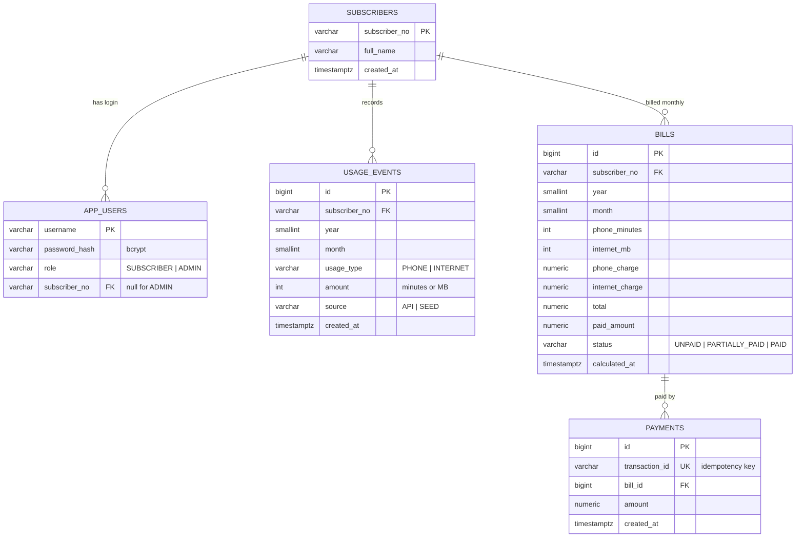

# ER / Data Model

## Design notes

| Rule | How it is enforced |
|---|---|
| One bill per subscriber per month | `UNIQUE (subscriber_no, year, month)` on `bills`; Calculate Bill does an upsert |
| Duplicate transaction IDs are rejected | `UNIQUE (transaction_id)` on `payments` + check in the service (HTTP 409) |
| Balance can never go below zero | Payment runs in a DB transaction with `SELECT ... FOR UPDATE` on the bill row; amount > remaining → HTTP 422 |
| Subscriber sees only own data | `app_users.subscriber_no` is copied into the JWT; ownership middleware compares it with the request |
| Remaining balance | Not stored; computed as `total − paid_amount` |
